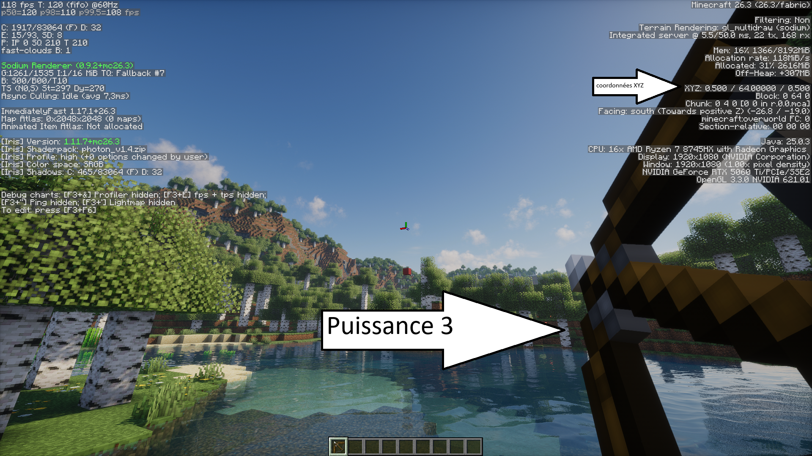
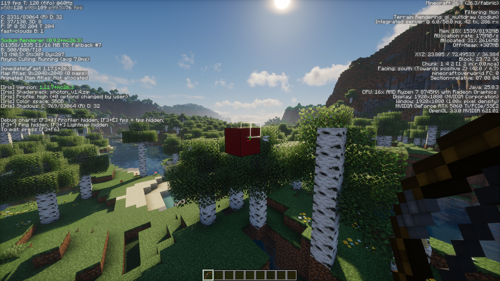

# Calculateur de tir à l'arc (Minecraft)

Projet du module « Outils fondamentaux » (IUT Nord Franche-Comté).
**Groupe :**  : Djelloul MILOUD, Ozan OZTURK, Dogan OZDEMIR

> Question de départ : *à quel angle faut-il tirer pour toucher un bloc donné, et quels tirs sont fiables ?*

## 1. Organisation du dépôt

| Dossier | Contenu |
|---|---|
| `tp/` | Solutions aux TP 1 à 6 (refaites par Dogan) |
| `projet/` | `calculateur_arc.py` (programme), `analyse.py` (études), `images/` (captures du test en jeu) |

## 2. Qui a fait quoi

| Membre | Contribution |
|---|---|
| **Djelloul** | Conception et écriture du programme Python, tests automatiques, **tests en jeu** (relevé des coordonnées, tirs, captures), rédaction du README |
| **Ozan** | Assistance sur le code du projet (relecture, aide à l'écriture et à la correction) |
| **Dogan** | Réalisation des solutions aux TP (`tp/`) et **création du dépôt GitHub** |

## 3. Lancer

Python 3.10+, aucune bibliothèque externe.

```
cd projet
python calculateur_arc.py          # programme interactif
python calculateur_arc.py --test   # tests automatiques
python analyse.py                  # études du §6 (tir en cloche, sensibilité, portée, Newton)
```

Le programme demande `X Y Z` du joueur (coordonnées F3, pieds), `X Y Z` de la cible, et si la cible est un bloc entier (réponse par défaut : oui, il vise alors le centre, +0,5 sur chaque coordonnée). Virgule ou point acceptés.

**Résultat** : le yaw, puis le pitch (écran F3) pour chaque niveau de charge possible.

Minecraft utilise une charge continue de 0 à 20 ticks. **Les niveaux 1, 2, 3 sont des paliers que nous avons choisis** :

| Niveau | Ticks | Vitesse initiale | Portée max (même hauteur) |
|---|---|---|---|
| 1 | 6 | 0,69 bloc/tick | 8,9 blocs |
| 2 | 12 | 1,56 bloc/tick | 38,5 blocs |
| 3 | 20 (max) | 3,00 blocs/tick | 116,3 blocs |

Vitesse : formule du jeu, `f = ticks/20`, `puissance = (f² + 2f)/3` (limitée à 1), `vitesse = puissance × 3`.

## 4. Méthode

1. **Géométrie du plan** : la 3D est ramenée à un plan vertical : distance horizontale `d`, dénivelé `dy` depuis le départ de la flèche (yeux : 1,62 − 0,1), yaw par `atan2(-dx, dz)`.
2. **Flottants et simulation** : la flèche avance tick par tick (gravité 0,05 ; traînée 0,99 sur chaque composante). La hauteur à la distance `d` s'obtient par interpolation linéaire entre deux ticks.
3. **Recherche de racine** : on cherche l'élévation telle que `hauteur(d, angle) − dy = 0`. Un balayage (pas de 0,25°) repère un changement de signe, puis notre **dichotomie** (tolérance 1e-9°) affine.
4. **Conversion** : pitch du jeu = −élévation (regarder en haut = pitch négatif).

**Pourquoi la dichotomie ?** La fonction vient d'une simulation (pas de dérivée exacte) et le balayage fournit déjà des intervalles encadrant la racine : la dichotomie converge toujours. §6.3 vérifie ce choix par la mesure.

## 5. Tests

**Automatiques (`--test`)** : cohérence interne, pas fidélité à Minecraft.
- vitesses initiales ; signe du yaw dans les 8 directions ;
- boucle de simulation comparée à une **formule fermée** (écart < 1e-6) ;
- chaque tir calculé est **re-simulé en 3D** par une fonction indépendante du solveur ; écart à la cible < 0,01 bloc ;
- cas limites (cible trop proche, à la verticale, hors de portée), saisies incorrectes.

**En jeu** (Djelloul) :

| | Valeur |
|---|---|
| Départ (F3) | 0,500 / 64,000 / 0,500 |
| Bloc visé | 20 / 74 / 40 |
| Réglage | yaw −26,8°, niveau 3 (charge max), pitch −19,0° |
| Résultat | la flèche touche le bloc |




Pour ce tir, la cible est à 44,7 blocs, `dy` = +8,98 : le modèle prédit un pitch d'environ −19,14°. L'écart de 0,14° représente ≈ 0,1 bloc à cette distance (voir la sensibilité), ce qui est cohérent avec l'impact observé.
Les légères différences entre les angles théoriques et ceux visibles sur les captures proviennent de l'imprécision du réglage manuel de la souris. Les coordonnées utilisées restent celles relevées directement dans Minecraft. Le tir atteint néanmoins la cible avec les valeurs calculées, ce qui valide expérimentalement le fonctionnement du modèle pour ce cas précis.

## 6. Résultats obtenus par le code (`analyse.py`)

### 6.1 Deux solutions par cible : tendu et cloche
À niveau 3, la plupart des cibles à portée ont **deux angles** (tir tendu et tir en cloche). Pour le tir de validation : tendu ≈ 19,1°, cloche ≈ 76,1°.

### 6.2 Sensibilité : le tir en cloche est beaucoup moins fiable
Décalage de l'impact (en blocs) pour **1° d'erreur** de pitch, niveau 3, cible à la même hauteur :

| Distance | Tendu | Cloche | Rapport |
|---|---|---|---|
| 30 blocs | 0,52 | 41,97 | ≈ 80 × |
| 60 blocs | 1,00 | 17,11 | ≈ 17 × |
| 90 blocs | 1,31 | 7,28 | ≈ 6 × |

Conclusion : **le tir tendu est à privilégier**. Le tir en cloche n'est utile que si un obstacle bloque la trajectoire tendue, et exige une précision que l'affichage F3 (1 décimale) ne permet pas de garantir à courte distance. L'avantage du tendu diminue avec la distance.

### 6.3 Dichotomie contre Newton (tir de validation, niveau 3)

| Méthode | Départ | Résultat |
|---|---|---|
| Dichotomie | [19 ; 19,25] | 19,1389° en **28** itérations |
| Newton | 10° | 4 itérations |
| Newton | 19° | 3 itérations |
| Newton | 25° | 4 itérations |
| Newton | 45° | 5 itérations |
| Newton | 0° | **échec** |
| Newton | 70° | **échec** |

Newton est environ 6 à 9 fois plus rapide **quand il converge**, mais échoue depuis 0° et 70° : la flèche retombe trop tôt, la fonction est alors constante (valeur sentinelle « trop court »), sa dérivée est nulle et la tangente ne mène nulle part. La dichotomie, guidée par le balayage, ne peut pas échouer de cette façon. **Notre choix est donc justifié par une mesure**, et pas seulement par un argument.

### 6.4 Portée maximale
Niveau 3 : ≈ 116 blocs à hauteur égale. Au-delà, aucun angle ne convient (le solveur le signale). Près de cette limite, les deux solutions (tendu / cloche) se rejoignent et se confondent à environ 0,9° d'écart.

## 7. Limites

- Constantes du jeu (gravité, traînée, hauteur des yeux, décalage de la flèche, vitesse max, convention de yaw) issues de nos connaissances, **validées uniquement par le tir en jeu du §5**.
- `calculateur_arc.py` ne renvoie que le tir tendu : le tir en cloche est étudié dans `analyse.py` mais pas encore affiché par le programme principal.
- Pas de dispersion aléatoire des flèches, pas d'obstacles, pas de vent.
- Un balayage à 0,25° peut manquer deux solutions très proches, près de la portée maximale.
- Cible à la verticale du joueur ou à moins de 0,5 bloc : refusée.
- Un seul tir validé en jeu à ce jour.

## 8. Utilisation de l'IA

## 8. Utilisation de l'IA

Une intelligence artificielle a été utilisée comme outil d'assistance au cours du projet, notamment pour la structuration du code et du README, la relecture, l'identification de pistes d'amélioration et la formulation de retours constructifs.
La conception, les tests et les expérimentations ont été réalisés et vérifiés par les membres du groupe.
